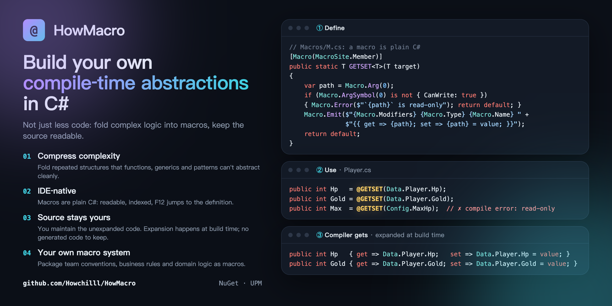

# HowMacro



**HowMacro gives C# developers the power to define their own compile-time abstractions.** It isn't just about writing less code:
complex, repetitive structures get folded into macros you write in ordinary C#, while the source you maintain stays readable.

- **Compress complexity.** Fold repeated structures that functions, generics and design patterns can't abstract cleanly.
- **IDE-native.** A macro is readable, indexed C#. The IDE sees each use as a normal method call or attribute,
  with completion, type checking and F12 to the macro's definition. No IDE plugin.
- **Source stays yours.** You only maintain the unexpanded source. The macro bodies run before compilation and expand
  into plain C#; there is no generated code to check in or keep in sync, and at runtime only the expanded result remains.
- **Your own macro system.** Write macros for your team's conventions, business rules and domain abstractions.

For example:

```csharp
public class Player
{
    // The IDE sees a field; the compiler gets a forwarding property
    public int Hp = @GETSET(DataCenter.PlayerData.Hp);

    // One shared rule: log every change; [@Save] registers the field with the save container automatically
    [@Save] public int Gold = @LOGGED(100);
    [@Save("lv")] public int Level = @LOGGED(1);
}
```

You can also wrap a group of members in `#region @LOG_ALL` … `#endregion` to process them together, for example to add change logging to every field while testing.

**Core principle: the unexpanded project must stay statically correct.** Names and types are declared only in source; macros change only the implementation.
So what the IDE shows is always the truth, and no IDE plugin is needed.

**To see it in a real project, look at [examples/Snake](https://github.com/Howchilll/HowMacro/blob/main/examples/Snake/README.md)**:
a terminal Snake game whose game logic is deliberately simple so the macros get the spotlight. It is a standalone project that consumes HowMacro through the NuGet package, with its macros written directly in the project's `Macros/` folder.
Its README walks from installation through configuration to running, so it doubles as an integration tutorial. 24 lines in the game use macros and they generate 171 lines of code:
change notification, value clamping, key bindings, a settings file, save data, Debug-only assertions and on-demand state tracing. The program at runtime contains no trace of the macros.

For a smaller example, see [samples/Showcase](https://github.com/Howchilll/HowMacro/blob/main/samples/Showcase/README.md): an RPG character module.

## Add it to your project

HowMacro is used as a NuGet package. **Reference the package, add one line of configuration, and you can start writing your own macros.**

### 1. Reference the package and say where macros live

```bash
dotnet add package HowMacro --prerelease
```

Then mark the reference compile-time only (`PrivateAssets="all"`, so it never flows to projects that reference yours)
and tell HowMacro which folder holds your macros. The project file ends up with:

```xml
<ItemGroup>
  <PackageReference Include="HowMacro" Version="0.1.6-preview" PrivateAssets="all" />
  <HowMacroDefinition Include="Macros/**/*.cs" />
</ItemGroup>
```

### 2. Write a macro in `Macros/`

```csharp
using HowMacro;

namespace MyApp.Macros;

public static class MyMacros
{
    [Macro(MacroSite.Statement)]
    public static void SHOW(object value) =>
        Macro.Emit($"System.Console.WriteLine({Macro.Quote(Macro.Arg(0) + " = ")} + ({Macro.Arg(0)}));");
}
```

### 3. Use it in your code

```csharp
using static MyApp.Macros.MyMacros;

var x = 21;
@SHOW(x * 2);   // prints: x * 2 = 42
```

That's it:

- No changes to your source structure, no IDE plugin.
- The IDE still completes macros and jumps to their implementation.
- The compiled program has no trace of HowMacro: not in the output folder, not in `deps.json`, not in assembly references.

**When you have many macros or want to share them across projects**, move them into a separate macro library project (netstandard2.0, also referencing the `HowMacro` package).
Other projects reference that macro library plus the `HowMacro` package; no `HowMacroDefinition` needed.

**Unit-testing macros**: reference the `HowMacro.Testing` package from your test project; see [DESIGN.md](https://github.com/Howchilll/HowMacro/blob/main/DESIGN.md#test-helpers-for-macro-authors).

**Requirements**: the build machine needs the .NET 10 SDK or later (the expansion tool runs on .NET 10), and the project must be an SDK-style MSBuild project.
The target framework of the project being expanded can be anything.

**Constraint on macro files**: files in `Macros/` are compiled before the rest of the project, so they can only use the HowMacro API and referenced libraries, not the project's own types.
Violating this reports HMC018; the reverse, regular code using an ordinary type from a macro file, reports HMC019.

### Where the packages come from

`HowMacro` and `HowMacro.Testing` are published to [nuget.org](https://www.nuget.org/packages/HowMacro), so the steps above work as is.
They are also published to GitHub Packages (`https://nuget.pkg.github.com/Howchilll/index.json`); NuGet feeds on GitHub Packages
always require authentication, even for public packages, so nuget.org is the easier choice.

### Build the packages from source

To try changes that aren't released yet, build the packages locally:

```bash
dotnet pack pack/HowMacro -c Release
```

```bash
dotnet pack src/HowMacro.Testing -c Release
```

The packages are written to `artifacts/packages/`. Put a `nuget.config` next to your project that adds this folder as a package source:

```xml
<configuration>
  <packageSources>
    <add key="howmacro-local" value="/path/to/HowMacro/artifacts/packages" />
  </packageSources>
</configuration>
```

## Building this repository

Requires the .NET 10 SDK. `samples/` and `tests/` reference the source directly (`build/HowMacro.targets` builds the expansion tool from source), so no packing is needed first.
The case study under `examples/` is a standalone project that consumes the NuGet package, so run `dotnet pack pack/HowMacro -c Release` first.

```bash
# Build and run the sample
dotnet build samples/Demo.App && dotnet samples/Demo.App/bin/Debug/net10.0/Demo.App.dll

# Run the macro unit tests
dotnet test tests/Demo.Macros.Tests

# Write the expanded output to howmacro-dump/ for debugging (optionally only some files or some macros)
dotnet build samples/Demo.App -p:HowMacroDumpFiles=Player.cs -p:HowMacroDumpMacros="LOGGED Save"
```

## Layout

| Path | Purpose |
|---|---|
| `src/HowMacro.Abstractions` | The API macro authors reference: `[Macro]`, `[AttributeMacro]`, `Macro.*`, the semantic information model |
| `src/HowMacro.Engine` | The expansion engine (Roslyn) |
| `src/HowMacro.Cli` | The expansion tool MSBuild calls during the build |
| `src/HowMacro.Testing` | Testing tools for macro authors (NuGet package `HowMacro.Testing`) |
| `src/HowMacro.Unity.Bridge` | Unity integration: expands and recompiles inside Unity's ILPostProcessor runner |
| `unity/` | Unity-side ILPostProcessor and setup notes ([unity/README.md](https://github.com/Howchilll/HowMacro/blob/main/unity/README.md)) |
| `pack/HowMacro` | Packaging project: produces the `HowMacro` NuGet package |
| `build/HowMacro.targets` | MSBuild integration |
| `examples/Snake` | Integration case study: terminal Snake, a standalone project consuming the NuGet package, macros written in-project (not in the main solution) |
| `samples/Showcase` | Value showcase: an RPG character module |
| `samples/Demo.*` | Basic samples for each feature |
| `tests/` | Unit tests for the sample macros |

The full design, rules, API and diagnostic codes are in [DESIGN.md](https://github.com/Howchilll/HowMacro/blob/main/DESIGN.md).

## Status

Prototype: plain .NET works (console, ASP.NET Core). Unity 2022.3+ works experimentally through an ILPostProcessor
(editor and player builds), installed as the UPM package `com.howmacro.unity`; see [unity/README.md](https://github.com/Howchilll/HowMacro/blob/main/unity/README.md).
